# Homework_05

This repository contains the scripts and result screenshots for homework_05.

## Task 1

- **Code:** [`script_01.sh`](./script_01.sh)
- **Result:** [`script_01_result.png`](./images/script_01_result.png)

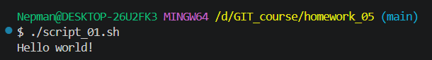

## Task 2

- **Code:** [`script_02.sh`](./script_02.sh)
- **Result:** [`script_02_result.png`](./images/script_02_result.png)

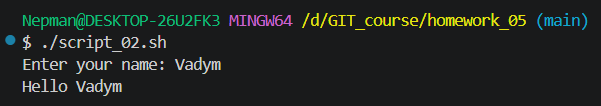

## Task 3

- **Code:** [`script_03.sh`](./script_03.sh)
- **Result:** [`script_03_result.png`](./images/script_03_result.png)

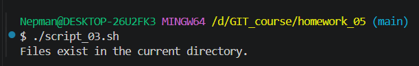

## Task 4

- **Code:** [`script_04.sh`](./script_04.sh)
- **Result:** [`script_04_result.png`](./images/script_04_result.png)

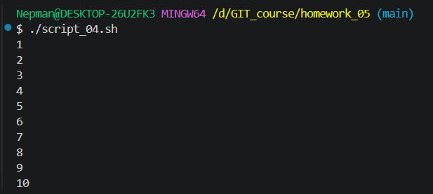

## Task 5

- **Code:** [`script_05.sh`](./script_05.sh)
- **Result:** [`script_05_result.png`](./images/script_05_result.png)

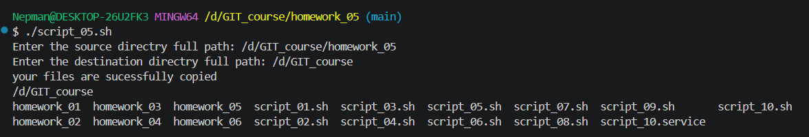

## Task 6

- **Code:** [`script_06.sh`](./script_06.sh)
- **Result:** [`script_06_result.png`](./images/script_06_result.png)

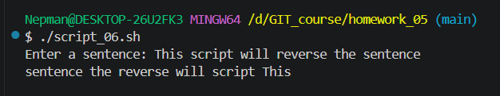

## Task 7

- **Code:** [`script_07.sh`](./script_07.sh)
- **Result:** [`script_07_result.png`](./images/script_07_result.png)

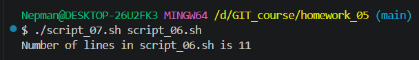

## Task 8

- **Code:** [`script_08.sh`](./script_08.sh)
- **Result:** [`script_08_result.png`](./images/script_08_result.png)

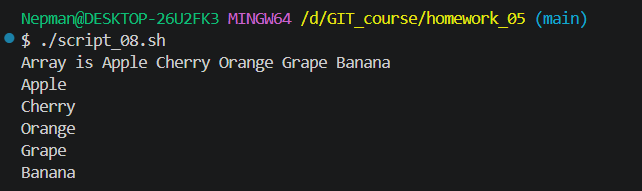

## Task 9

- **Code:** [`script_09.sh`](./script_09.sh)
- **Result:** [`script_09_result.png`](./images/script_09_result.png)

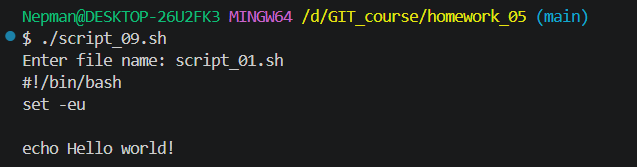

## Task 10

- **Code:** [`script_10.sh`](./script_10.sh)
- **Service unit:** [`script_10.service`](./script_10.service)
- **Result:** [`script_10_result.png`](./images/script_10_result.png)
- **Additional result:** [`script_10_result_unit.png`](./images/script_10_result_unit.png)

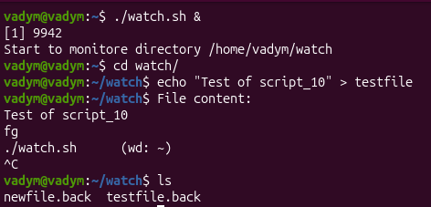

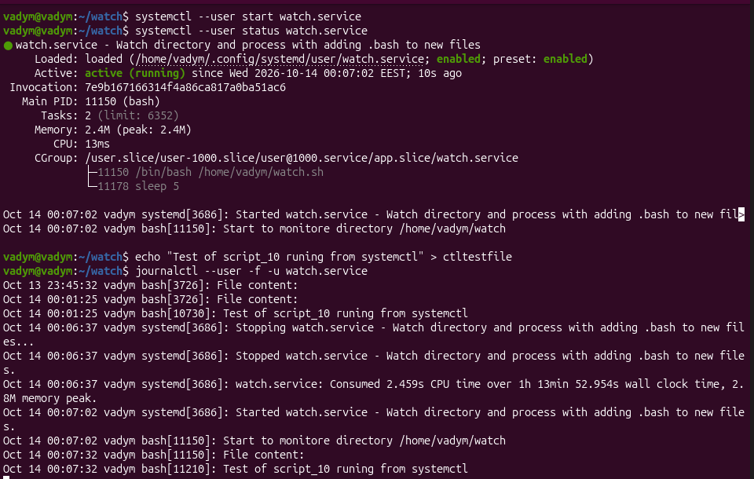
