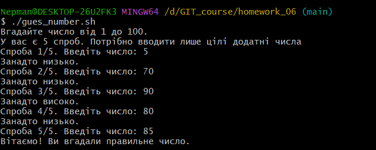
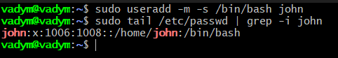
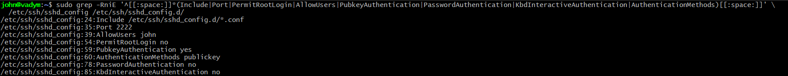
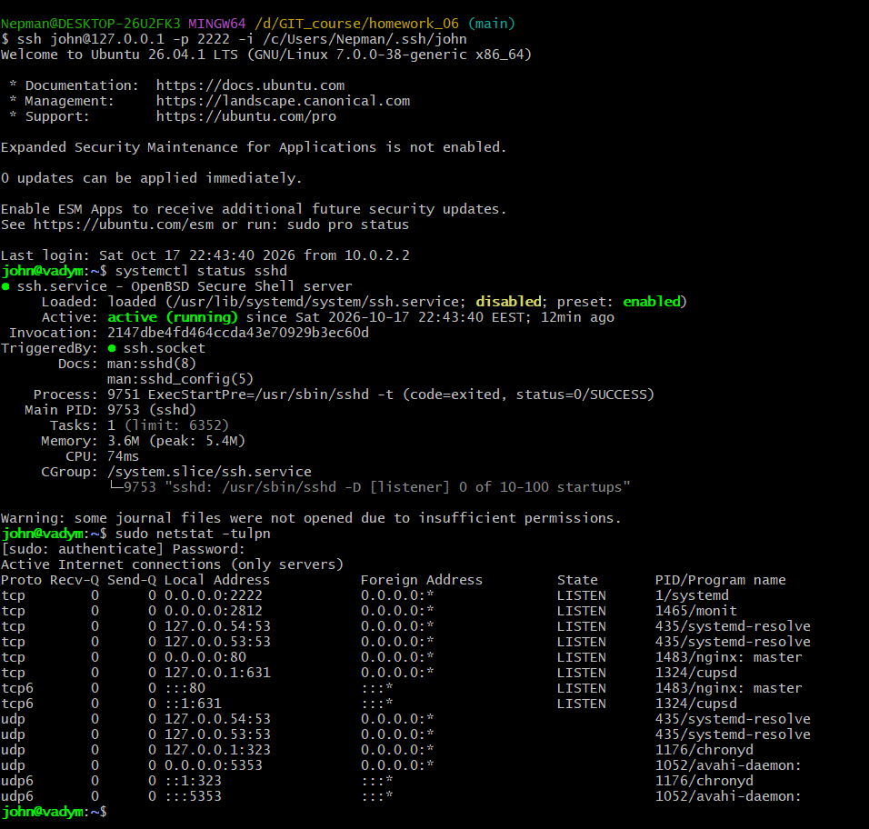
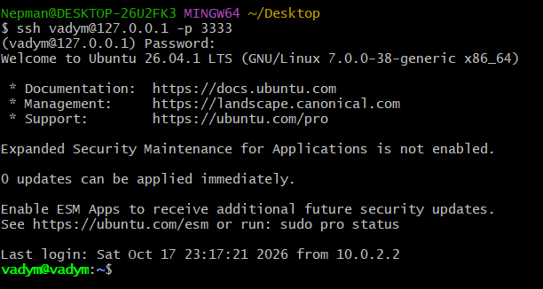
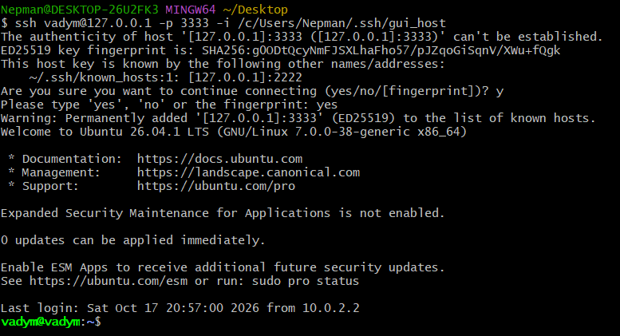

# Homework_06

This repository contains the scripts and result screenshots for homework_06.

# Task 1

You can find code for this script here: [`gues_number.sh`](./gues_number.sh)

# Task 2

> User created by command _sudo useradd -m -s /bin/bash john_. After that user was added to sudo group _usermod -aG sudo_ to show the result after connecting via it

# Task 3

For this request were updated socket file and config file

Follow the link to check the socket file: [`socket`](./ssh_configuration.socket)

Follow the link to check the unti file: [`unit`](./ssh_john.txt)

> On this screenshot you can check the related sshd configuration after changes: 

> Here you can find result of connection via user john and following checking of sshd configuration and the related socket status: 

# Task 4

Configuration of debug file you can check here: [`configuration_for_debug`](./ssh_conf_debug.txt)

>Result of connection using password: 

>Result of connection using public key: 

Thank you for checking and have a nice day